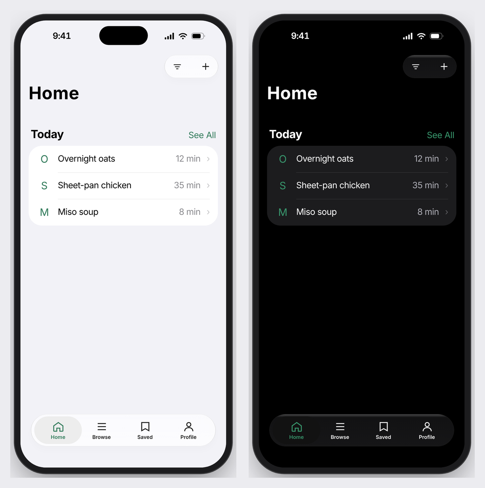
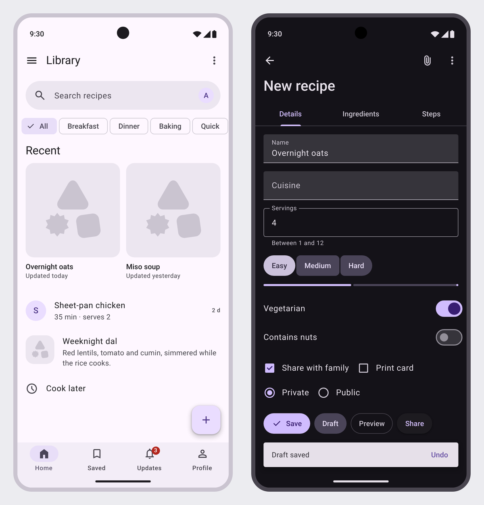
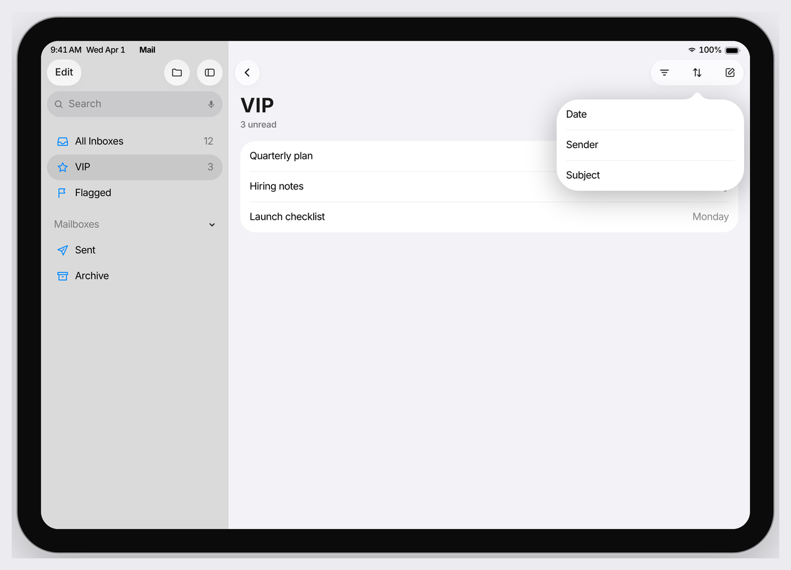
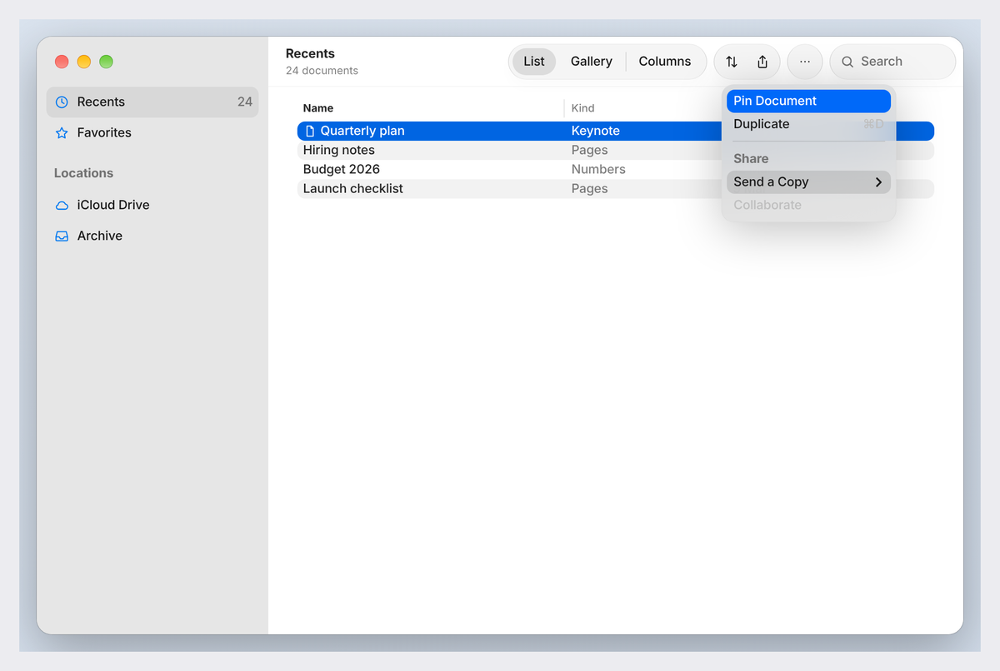

# hig

**Make AI-built app designs look native on iPhone, iPad, Mac and Android.**

<p align="center">
  
  
</p>
<p align="center">
  
  
</p>

AI coding agents design from memory, and their memory is out of date.
They reach for `#007AFF` when iOS 27's blue is `#0088FF`, draw the grey
tab bar Apple retired, and build Android screens that read as web pages.
This repo replaces the memory with measurements. Every size, colour and
corner comes from Apple's and Google's own design kits, and every design
is checked in a real browser before it's handed over.

It is five agent skills. You describe what you want; the designs come out
as plain web pages you can open, share and hand to an engineer, and as
SwiftUI when you're ready to build for real. Apple's guidelines stay on
Apple's site: the skills know which page answers a question and link it,
rather than carrying a copy.

## What it covers

| Platform | Measured from | What makes it read as native |
|---|---|---|
| **iPhone** (iOS 27) | Apple's iOS and iPadOS 27 design kit | The wide glass tab bar, floating glass buttons, large titles, grouped lists, the 62pt status bar, and black text with `#1A1A1A` on glass |
| **iPad** (iPadOS 27) | The same kit | The 320pt glass sidebar beside the content, or tabs at the top centre; sheets and popovers with 38pt corners |
| **Mac** (macOS 27) | Apple's macOS 27 design kit | The window with its traffic lights, sidebar and glass toolbar; 13pt text and 24pt controls |
| **Android** (Material 3) | Google's Material 3 Design Kit | The top app bar, nav bar and FAB, Roboto, Material Symbols, and a full colour scheme derived from your brand colour |
| **Web** | Apple's design principles | Sites and dashboards that feel like Apple without wearing iPhone chrome |

## Set up

**In Claude Code, install the plugin.** Type these inside Claude Code:

```text
/plugin marketplace add doppe7gangar/hig
/plugin install hig@hig
```

On Claude Code 2.1.275 or later, `/plugin install hig --marketplace doppe7gangar/hig`
does both in one step. The plugin brings the five skills, plus
[commands, review agents and automatic checks](#commands-agents-and-checks), and `/plugin`
updates it when a new version is out.

**Or install the skills alone, pinned to a release.** Download the
installer for a release, read it, then run it:

```bash
curl -fsSLO https://github.com/doppe7gangar/hig/releases/download/v1.0.0/install.sh
less install.sh
bash install.sh
```

It installs that exact release and checks the download is the commit the
release was published with; the release page lists that commit and the
installer's SHA-256. Your current copies of the five skills are
saved first, and other skills you have aren't touched. `bash install.sh
--dry-run` shows what would change without changing anything; `--rollback`
puts back what you had; `--checks` also installs Playwright, which lets the
skills screenshot and check their designs. A newer release comes with its
own installer: download that one the same way.

Use one or the other: with both, every skill loads twice. To move from the
installer to the plugin, run `bash install.sh --rollback` first.

No Claude Code yet? Run `curl -fsSL https://claude.ai/install.sh | bash` first.

**Then use it.** You don't call the skills by name. Start `claude` in a
folder for your project, describe what you want, and the right skill
picks itself:

```bash
mkdir ~/Desktop/plant-app && cd ~/Desktop/plant-app && claude
```

> Design an iPhone app for tracking when my house plants need watering.

The designs are web pages you can tap through: tabs switch screens, rows open
their detail, sheets open and close. Nothing needs Xcode or Android Studio. Open
one with `open design/index.html`. On a Mac, Safari draws it in Apple's
own SF Pro.

**Using another tool.** The skills are plain Markdown, CSS and Python,
with nothing tied to one agent. The install line leaves a copy of
everything in `~/.hig` to take them from.

- **The Claude app** (web, desktop or phone): zip a skill and upload it
  in the app's skill settings, e.g.
  `cd ~/.hig/.claude/skills && zip -r ~/Desktop/apple-ui-kit.zip apple-ui-kit`.
  Each skill is small enough to upload. The app can't run the checks on
  your Mac.
- **Cursor, Copilot, Windsurf, Zed, aider** and anything else that reads
  `AGENTS.md`: copy [AGENTS.md](AGENTS.md) and `.claude/skills/` from
  `~/.hig` into your project.
- **No AI at all**: the kits are ordinary CSS, fonts and example pages.
  Open an example and copy the markup.

## What to ask for

| You want to… | Say something like | You get |
|---|---|---|
| Turn an idea into an app or site | *"I want an app for splitting bills with friends"* | The screens and how they connect, a working project with its loading, empty and error states, and a checker run before it's handed over |
| Design for a particular device | *"Design the iPad version"*, *"…as a Mac app"*, *"…for Android"* | That platform's own structure and parts, not the iPhone design stretched to fit |
| Use your brand | *"Our colour is #C1552E"* | A palette tuned for contrast in light and dark; on Android, a full Material scheme from the one colour |
| Make an existing UI look like iOS | *"Make this settings page feel like an Apple app"* | Apple's measured colours, type and control sizes as tokens, plus ready CSS components |
| Build it in React or Tailwind | *"Give me an iOS-style settings screen in React"* | Accessible React components over the same recipes, and a Tailwind v4/v3 theme |
| Get it in Figma | *"Send it to Figma"* | A frame for every screen and state, light and dark, in a Figma file. Needs Figma's MCP server: `claude mcp add --transport http figma https://mcp.figma.com/mcp`, then `/mcp` to sign in |
| Turn an approved design into SwiftUI | *"The design in ./design is approved. Write the SwiftUI app"* | Views per screen with a preview per state, checked against the design for anything lost |
| Check a design or SwiftUI code | *"Review this screen before I ship it"* | Findings sorted into hard violations, soft guidance and judgment calls, each citing Apple's page |
| Get a straight answer | *"Sheet or popover here?"*, *"Is this button too small?"* | Apple's number or rule, quoted, with where it says so |
| Make it move right | *"This transition feels floaty"* | The spring, the timing, and the Reduce Motion fallback |

### Try it in five minutes

Open Claude Code in an empty folder and paste:

> build me a simple expense tracker web page: a list of expenses, a total
> at the top, and an add button. make it feel like an Apple app.

**It worked if** the CSS uses `var(--ios-accent)` and friends rather than
raw hex codes, and `tokens/ios-tokens.css` and `ios-components.css` were
copied in rather than reinvented. **It didn't if** you see `#007AFF`
anywhere. That's the old accent from search results.

For a whole product, grade what's on disk, not what the transcript says:
`/hig:check ./design` with the plugin, or with the installer

```bash
python3 ~/.claude/skills/apple-design/check_design.py ./design
```

More recipes, and what good output looks like for each, are in
[TESTING.md](TESTING.md).

## The five skills

| Skill | What it does |
|---|---|
| [`apple-design`](.claude/skills/apple-design/SKILL.md) | Runs the job: idea, screens, a scaffolded project for iPhone, iPad, Mac, Android or the web, a checked design, then SwiftUI |
| [`apple-ui-kit`](.claude/skills/apple-ui-kit/SKILL.md) | Apple's measured values and parts: iOS 27 tokens for CSS, SwiftUI, Compose, Android XML, Flutter and TypeScript; web, React and Tailwind components; iPadOS 27 layouts; macOS 27 windows |
| [`android-ui-kit`](.claude/skills/android-ui-kit/SKILL.md) | Material 3: the colour scheme, Roboto type scale and components from Google's kit, Material Symbols, and a theme builder for CSS, Compose and Android XML |
| [`apple-hig`](.claude/skills/apple-hig/SKILL.md) | Apple's guidelines, put to work: which official page answers a question, the figures reached for most, an API map across 32 frameworks, 3,150 system components by name, and a SwiftUI checker |
| [`apple-motion`](.claude/skills/apple-motion/SKILL.md) | Springs, transitions, haptic pairing, Reduce Motion |

## Commands, agents and checks

The plugin adds these on top of the skills. The skills pick themselves from
what you ask; the commands are for when you know which step you want.

| Command | What it does |
|---|---|
| `/hig:design <what you want>` | A brief to a working, checked prototype: settle the screens, scaffold, build, check in a browser, render and review |
| `/hig:check [folder]` | Every mechanical check on a design (taps, states, contrast, use of the kit, licences), fixed until it passes |
| `/hig:review [files]` | A review of SwiftUI, UIKit, AppKit or a design against the HIG: violations, guidance and judgment, each linked to Apple's page |
| `/hig:ask <question>` | The answer from Apple's page itself, with the link, each figure's platform, and quotes checked word for word |
| `/hig:figma [folder]` | Every screen and state into Figma, light and dark |
| `/hig:handoff [design] [app]` | The design into SwiftUI, checked for anything lost on the way |
| `/hig:ship [folder]` | Ready to publish: it won't call a design ready while it carries SF Pro, SF Symbols or a file without its licence |

Two agents take the reading-heavy work into their own context, so your
conversation stays on the design. Claude hands work to them when it fits,
or ask for one by name, e.g. `@agent-hig:reviewer look at SettingsView.swift`:

- **`hig:reviewer`** reviews code or a design against the HIG, reading
  Apple's pages, and returns findings sorted into violations, guidance and
  judgment. It doesn't edit anything.
- **`hig:design-critic`** renders a design, holds each screen against the
  platform's own example screens, and ranks what most gives it away as not
  native.

Two checks run by themselves:

- **After Claude writes or edits a `.swift` file**, `check_swiftui.py` runs
  on it and the violations go straight back to Claude to fix.
- **Before `git commit` or `git push`**, every design in the repository is
  checked, and the command is stopped if SF Pro, SF Symbols or Apple's
  images would go along with it.

To turn either off, set `HIG_SWIFTUI_HOOK` or `HIG_COMMIT_GUARD` to `off`
in the `env` of `~/.claude/settings.json`.

### In your own CI

The same checks run as a GitHub Action, with each finding on the pull
request's diff at its line:

```yaml
- uses: actions/checkout@v4
- uses: doppe7gangar/hig@v1.0.0
  with:
    swiftui: MyApp     # Swift files or folders
    designs: design    # design folders, checked before they're published
```

`fail-on: guidance` also fails on Apple's advice; `fail-on: none` only
reports. `purpose: mockup` applies the rules for a working mockup instead of
a published one.

## How it stays right

Values are measured, never remembered, and each comes from more than one
place. Apple publishes its system palette on the HIG's Color page. The
colour variables in Apple's iOS 27 design kit name every system colour in
light and dark. 945 renderings from the kit give the geometry. Where the
sources overlap they agree, and the build fails if a measured colour
loses its corroboration.

Each kit has a browser test that measures its example page against
numbers written into the test, so a recipe can't drift quietly:

| Kit | Test | What it measures |
|---|---|---|
| iPhone | `verify_web_ui.py` | 218 checks: tokens, type, controls, contrast, and the iOS 27 tab bar, status bar and glass |
| iPad | `verify_ipad_ui.py` | 67 checks: the frame, sidebar, toolbar, top tab bar, sheet and popover |
| Mac | `verify_mac_ui.py` | 87 checks: the window, its lights and toolbar, controls, menus and tables, in light, dark and Increased Contrast |
| Android | `verify_android_ui.py` | 268 checks: every component and colour role, and the theme builder against Google's own scheme |

`check_design.py` holds every finished design to the same standard. The
brand theme loads last, the page opens offline, all four states render,
text clears its contrast in both appearances, and the platform's own
structure is there: an iPad design with the iPhone's bottom tab bar
fails, and so does an Android screen in Apple's chrome.
`python3 scripts/doctor.py` checks that every count and path in these
docs is still true.

## The numbers you'll reach for most

From the guidelines and the design kits. Each one is in
`.claude/skills/apple-hig/references/numbers.md` or a kit's tokens, with its
source.

| What | Value |
|---|---|
| Minimum tap target | iOS and iPadOS 44×44 pt (28×28 pt floor) · Android 48×48 dp |
| Text contrast | 4.5:1 up to 17 pt; 3:1 at 18 pt or bold |
| iOS text sizes (default) | Large Title 34 · Title 1 28 · Title 2 22 · Title 3 20 · Body 17 · Subhead 15 · Footnote 13 · Caption 12 / 11 |
| Mac text and controls | Body 13 pt; controls 24 pt tall |
| Accent colour, iOS 27 | `#0088FF` (not `#007AFF`) |
| Text colour, iOS 27 | Black on a plain background; `#1A1A1A` on glass (bars, buttons, tabs) |

## Find the guidance for what you're building

Grouped by the job in front of you rather than by Apple's chapter order.
Each link opens Apple's page.

| Building… | Read |
|---|---|
| A list, settings or detail screen | [Lists and tables](https://developer.apple.com/design/human-interface-guidelines/lists-and-tables) · [Settings](https://developer.apple.com/design/human-interface-guidelines/settings) · [Toggles](https://developer.apple.com/design/human-interface-guidelines/toggles) · [Layout](https://developer.apple.com/design/human-interface-guidelines/layout) |
| Navigation between screens | [Tab bars](https://developer.apple.com/design/human-interface-guidelines/tab-bars) · [Sidebars](https://developer.apple.com/design/human-interface-guidelines/sidebars) · [Split views](https://developer.apple.com/design/human-interface-guidelines/split-views) · [Toolbars](https://developer.apple.com/design/human-interface-guidelines/toolbars) |
| Asking the user to confirm or choose | [Alerts](https://developer.apple.com/design/human-interface-guidelines/alerts) · [Action sheets](https://developer.apple.com/design/human-interface-guidelines/action-sheets) · [Sheets](https://developer.apple.com/design/human-interface-guidelines/sheets) · [Popovers](https://developer.apple.com/design/human-interface-guidelines/popovers) · [Modality](https://developer.apple.com/design/human-interface-guidelines/modality) |
| Menus and buttons | [Buttons](https://developer.apple.com/design/human-interface-guidelines/buttons) · [Menus](https://developer.apple.com/design/human-interface-guidelines/menus) · [Context menus](https://developer.apple.com/design/human-interface-guidelines/context-menus) · [Pop-up buttons](https://developer.apple.com/design/human-interface-guidelines/pop-up-buttons) · [Pull-down buttons](https://developer.apple.com/design/human-interface-guidelines/pull-down-buttons) |
| Forms and data entry | [Entering data](https://developer.apple.com/design/human-interface-guidelines/entering-data) · [Text fields](https://developer.apple.com/design/human-interface-guidelines/text-fields) · [Pickers](https://developer.apple.com/design/human-interface-guidelines/pickers) · [Steppers](https://developer.apple.com/design/human-interface-guidelines/steppers) · [Segmented controls](https://developer.apple.com/design/human-interface-guidelines/segmented-controls) · [Virtual keyboards](https://developer.apple.com/design/human-interface-guidelines/virtual-keyboards) |
| Search | [Searching](https://developer.apple.com/design/human-interface-guidelines/searching) · [Search fields](https://developer.apple.com/design/human-interface-guidelines/search-fields) |
| Empty, loading and error states | [Loading](https://developer.apple.com/design/human-interface-guidelines/loading) · [Feedback](https://developer.apple.com/design/human-interface-guidelines/feedback) · [Progress indicators](https://developer.apple.com/design/human-interface-guidelines/progress-indicators) |
| First run, sign-in and accounts | [Launching](https://developer.apple.com/design/human-interface-guidelines/launching) · [Onboarding](https://developer.apple.com/design/human-interface-guidelines/onboarding) · [Managing accounts](https://developer.apple.com/design/human-interface-guidelines/managing-accounts) · [Sign in with Apple](https://developer.apple.com/design/human-interface-guidelines/sign-in-with-apple) · [Privacy](https://developer.apple.com/design/human-interface-guidelines/privacy) |
| Notifications, widgets, Live Activities | [Managing notifications](https://developer.apple.com/design/human-interface-guidelines/managing-notifications) · [Notifications](https://developer.apple.com/design/human-interface-guidelines/notifications) · [Widgets](https://developer.apple.com/design/human-interface-guidelines/widgets) · [Live Activities](https://developer.apple.com/design/human-interface-guidelines/live-activities) |
| Taking payment | [Apple Pay](https://developer.apple.com/design/human-interface-guidelines/apple-pay) · [In-app purchase](https://developer.apple.com/design/human-interface-guidelines/in-app-purchase) · [Wallet](https://developer.apple.com/design/human-interface-guidelines/wallet) |
| Charts and dashboards | [Charting data](https://developer.apple.com/design/human-interface-guidelines/charting-data) · [Charts](https://developer.apple.com/design/human-interface-guidelines/charts) · [Gauges](https://developer.apple.com/design/human-interface-guidelines/gauges) |
| The look: colour, type, icons, materials | [Color](https://developer.apple.com/design/human-interface-guidelines/color) · [Dark Mode](https://developer.apple.com/design/human-interface-guidelines/dark-mode) · [Typography](https://developer.apple.com/design/human-interface-guidelines/typography) · [SF Symbols](https://developer.apple.com/design/human-interface-guidelines/sf-symbols) · [Materials](https://developer.apple.com/design/human-interface-guidelines/materials) · [App icons](https://developer.apple.com/design/human-interface-guidelines/app-icons) |
| Motion and haptics | [Motion](https://developer.apple.com/design/human-interface-guidelines/motion) · [Playing haptics](https://developer.apple.com/design/human-interface-guidelines/playing-haptics) · [Gestures](https://developer.apple.com/design/human-interface-guidelines/gestures) |
| Something everyone can use | [Accessibility](https://developer.apple.com/design/human-interface-guidelines/accessibility) · [VoiceOver](https://developer.apple.com/design/human-interface-guidelines/voiceover) · [Inclusion](https://developer.apple.com/design/human-interface-guidelines/inclusion) · [Right to left](https://developer.apple.com/design/human-interface-guidelines/right-to-left) · [Writing](https://developer.apple.com/design/human-interface-guidelines/writing) |
| The same app on another device | [iOS](https://developer.apple.com/design/human-interface-guidelines/designing-for-ios) · [iPadOS](https://developer.apple.com/design/human-interface-guidelines/designing-for-ipados) · [macOS](https://developer.apple.com/design/human-interface-guidelines/designing-for-macos) · [watchOS](https://developer.apple.com/design/human-interface-guidelines/designing-for-watchos) · [tvOS](https://developer.apple.com/design/human-interface-guidelines/designing-for-tvos) · [visionOS](https://developer.apple.com/design/human-interface-guidelines/designing-for-visionos) · [games](https://developer.apple.com/design/human-interface-guidelines/designing-for-games) |
| An AI feature | [Generative AI](https://developer.apple.com/design/human-interface-guidelines/generative-ai) · [Machine learning](https://developer.apple.com/design/human-interface-guidelines/machine-learning) |

Everything else: **[every page, with the platforms it covers](.claude/skills/apple-hig/references/topics.md)**, or [the guidelines on Apple's site](https://developer.apple.com/design/human-interface-guidelines).

## Without an AI

The references are plain Markdown, so a terminal is enough:

```bash
cd ~/.claude/skills/apple-hig/references
grep -i sheet topics.md                # the official page, and its platforms
grep -A12 "^## Buttons" numbers.md     # the numbers
grep -A4 "^\*\*Sheets\*\*" api-map.md   # the SwiftUI / UIKit / AppKit API
```

Read what Apple says, from Apple's site, and check an answer's quotes
against the pages it links:

```bash
python3 ~/.claude/skills/apple-hig/hig_page.py sheets --section "Platform considerations"
pbpaste | python3 ~/.claude/skills/apple-hig/check_quotes.py -
```

Check SwiftUI code before it ships, for fixed font sizes, colours that
won't adapt, unlabelled icon buttons, destructive buttons without the role
and small targets, each finding citing its page:

```bash
python3 ~/.claude/skills/apple-hig/check_swiftui.py MyApp/
```

Check SwiftUI written from one of the mockups, screen by screen and state
by state, for titles, tabs, symbols and controls lost on the way:

```bash
python3 ~/.claude/skills/apple-design/check_handoff.py ./design MyApp/
```

On a Mac, run `python3 ~/.claude/skills/apple-hig/sf_symbols.py --install`
once and the checks cover SF Symbol names too. A misspelt name, or one
newer than your deployment target, draws nothing and nothing warns you.
It copies the names from your own Mac, not the symbols, so nothing of
Apple's ships here.

Turn a brand colour into an Android colour scheme for Compose:

```bash
python3 ~/.claude/skills/android-ui-kit/build_m3_theme.py "#C1552E" --format compose -o Color.kt
```

## What's in here

| Path | What it is |
|---|---|
| `.claude/skills/` | The five skills above, each with its own `SKILL.md` |
| `skills/`, `agents/`, `hooks/` | The plugin's commands, agents and automatic checks |
| `.claude-plugin/` | The plugin and its marketplace, for `/plugin install` |
| `action.yml` | The GitHub Action |
| `scripts/` | The token builders and the checks |
| `docs/` | The images on this page |
| [AGENTS.md](AGENTS.md) | The same routing for agents that don't read `.claude/skills/` |

## Keeping it current

Apple revises the guidelines every OS cycle. The links always open the
current page; the figures and lists here are refreshed from Apple's site:

```bash
python3 scripts/fetch_platform_metadata.py  # which platforms each page covers
python3 scripts/scrape_frameworks.py        # the system component names
python3 scripts/doctor.py                   # every count and claim in the docs still true?
python3 scripts/provenance_guard.py         # nothing of Apple's copied in
python3 scripts/check_licences.py           # every third-party file against its licence
```

Re-measuring a kit needs your own copy of Apple's design resources,
exported as PNGs: point `APPLE_UI_KIT_PNGS` at the folder and run
`scripts/extract_ui_kit_tokens.py`, then `scripts/build_design_tokens.py`.
Apple's licence doesn't allow passing those resources on, so they never
come into this repo.

To release: set `VERSION` in `install.sh` to the new tag and `version` in
`.claude-plugin/plugin.json` to the same number without the `v`, commit,
then push the tag (`git tag v1.1.0 && git push origin v1.1.0`). Plugin users
get the update through `/plugin` once the version changes. The release
workflow runs the whole suite, refuses a tag that isn't a version on `main`
or that either file disagrees with, checks every third-party file against its
licence and Material Symbols against their source, and only then publishes
`install.sh` pinned to that commit, with `licences.json` (each third-party
file, its licence and where it comes from) and checksums for every file.

Testing the skills themselves: [TESTING.md](TESTING.md) for the reference
and kit skills, [DESIGN_TESTING.md](DESIGN_TESTING.md) for the design
workflow, and [scripts/eval/README.md](scripts/eval/README.md) before
trusting any triggering result.

## Notes

- The Human Interface Guidelines, Apple's design resources and SF Symbols
  belong to Apple, and none of them is included here: the skills link to
  Apple's pages, and measured values are recorded as figures with their
  source. Material Design belongs to Google.
- SF Pro isn't included either: Apple's licence doesn't allow
  redistributing it. Macs and iPhones use their own copy anyway, and
  elsewhere pages fall back to Inter. If you have Apple's SF Pro download,
  `.claude/skills/apple-ui-kit/fonts/sf.css` explains how to use your own
  copy for mockups; `sf_icons.py` does the same for SF Symbols on a Mac.
- Bundled with their licences: Inter and Roboto (SIL Open Font License)
  and Material Symbols (Apache 2.0). `apple-motion` adapts MIT-licensed
  material. [NOTICE](NOTICE) lists where every file comes from.
- Designs carry their licences too. `new_project.py` writes the licence of
  everything it copies into a design, and
  `python3 .claude/skills/apple-design/check_distribution.py ./design --purpose publish`
  checks a design before it's shared or published: it fails on SF Pro and
  SF Symbols from your Mac, Apple's design-resource images, fonts or icons
  without their licence, and images nobody recorded.

## License

The original work in this repository is licensed under the
[Apache License 2.0](LICENSE). That covers only what the authors wrote or
measured; the third-party material listed in [NOTICE](NOTICE) keeps its
own licence, and Apple's and Google's guidelines and design resources are
not part of it.
