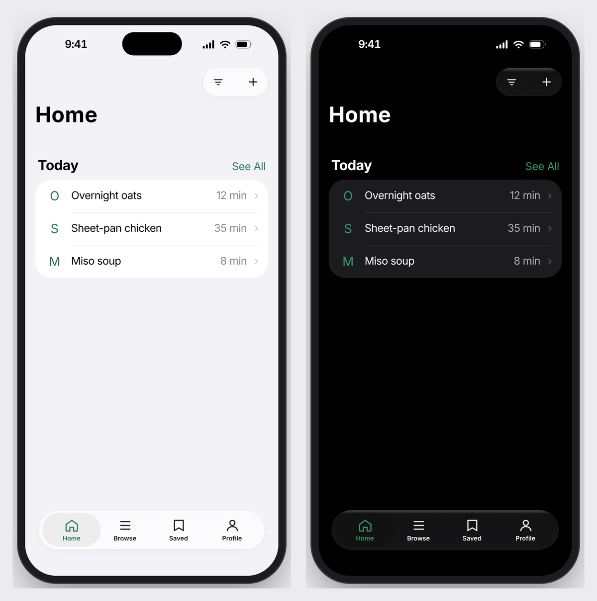
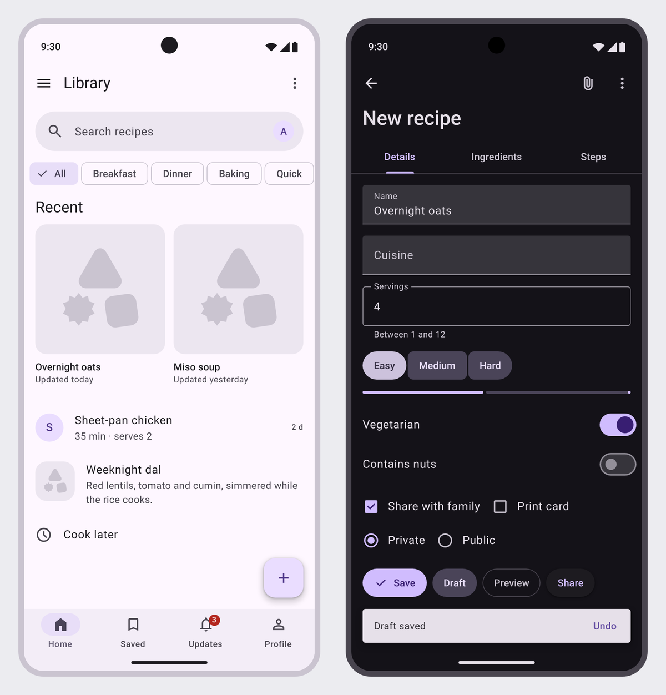
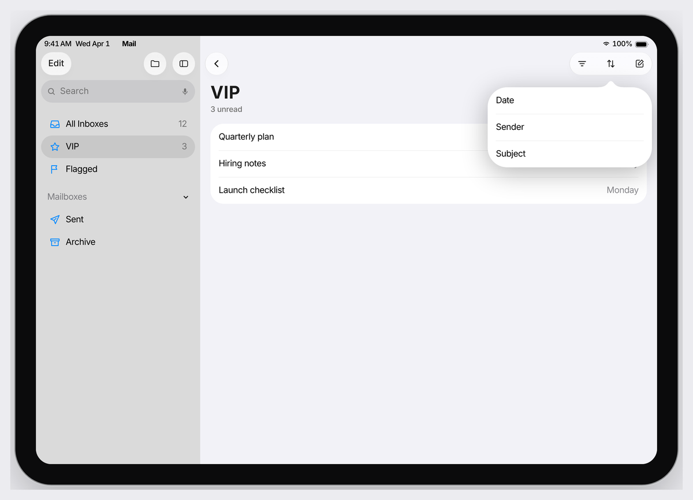
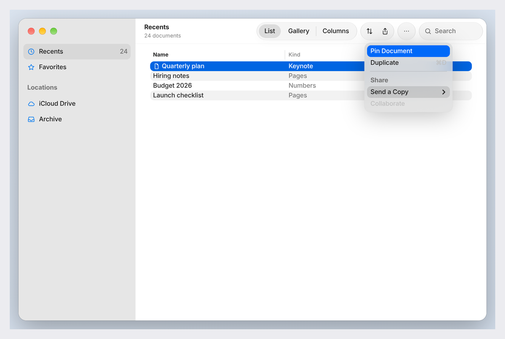

# hig

**Make AI-built app designs look native on iPhone, iPad, Mac and Android.**

<p align="center">
  
  
</p>
<p align="center">
  
  
</p>

AI coding agents design from memory, and their memory is out of date.
They reach for `#007AFF` when iOS 27's blue is `#0088FF`, draw the grey
tab bar Apple retired, and build Android screens that read as web pages.
This repo replaces the memory with measurements. Every size, colour and
corner comes from Apple's and Google's own design kits, and every design
is checked in a real browser before it's handed over.

It is five agent skills plus Apple's complete Human Interface Guidelines
as offline Markdown. You describe what you want; the designs come out as
plain web pages you can open, share and hand to an engineer, and as
SwiftUI when you're ready to build for real.

## What it covers

| Platform | Measured from | What makes it read as native |
|---|---|---|
| **iPhone** (iOS 27) | Apple's iOS and iPadOS 27 design kit | The wide glass tab bar, floating glass buttons, large titles, grouped lists, the 62pt status bar, and black text with `#1A1A1A` on glass |
| **iPad** (iPadOS 27) | The same kit | The 320pt glass sidebar beside the content, or tabs at the top centre; sheets and popovers with 38pt corners |
| **Mac** (macOS 27) | Apple's macOS 27 design kit | The window with its traffic lights, sidebar and glass toolbar; 13pt text and 24pt controls |
| **Android** (Material 3) | Google's Material 3 Design Kit | The top app bar, nav bar and FAB, Roboto, Material Symbols, and a full colour scheme derived from your brand colour |
| **Web** | Apple's design principles | Sites and dashboards that feel like Apple without wearing iPhone chrome |

## Set up

One line in Terminal installs everything for every project:

```bash
curl -fsSL https://raw.githubusercontent.com/doppe7gangar/hig/main/install.sh | bash
```

Run the same line again to update. To also install Playwright, which lets
the skills screenshot and check their designs, end it with
`| bash -s -- --checks` instead. Don't have Claude Code yet? Run
`curl -fsSL https://claude.ai/install.sh | bash` first.

You don't call the skills by name. Start `claude` in any folder, describe
what you want, and the right one picks itself.

The designs are web pages, so nothing needs Xcode or Android Studio. Open
one with `open design/index.html`. On a Mac, Safari draws it in Apple's
own SF Pro.

**Using another tool.** The skills are plain Markdown and Python, with
nothing tied to one agent.

- **The Claude app** (web, desktop or phone): zip a skill folder and upload
  it in the app's skill settings. The design and kit skills are small;
  `apple-hig` is too big to upload because of its screenshots.
- **Cursor, Copilot, Windsurf, Zed, aider** and anything else that reads
  `AGENTS.md`: copy [AGENTS.md](AGENTS.md) and `.claude/skills/` into your
  project.
- **No AI at all**: the kits are ordinary CSS, fonts and example pages.
  Open an example and copy the markup.

## What to ask for

| You want to… | Say something like | You get |
|---|---|---|
| Turn an idea into an app or site | *"I want an app for splitting bills with friends"* | The screens and how they connect, a working project with its loading, empty and error states, and a checker run before it's handed over |
| Design for a particular device | *"Design the iPad version"*, *"…as a Mac app"*, *"…for Android"* | That platform's own structure and parts, not the iPhone design stretched to fit |
| Use your brand | *"Our colour is #C1552E"* | A palette tuned for contrast in light and dark; on Android, a full Material scheme from the one colour |
| Make an existing UI look like iOS | *"Make this settings page feel like an Apple app"* | Apple's measured colours, type and control sizes as tokens, plus ready CSS components |
| Build it in React or Tailwind | *"Give me an iOS-style settings screen in React"* | Accessible React components over the same recipes, and a Tailwind v4/v3 theme |
| Turn an approved design into SwiftUI | *"The design in ./design is approved. Write the SwiftUI app"* | Views per screen with a preview per state, checked against the design for anything lost |
| Check a design or SwiftUI code | *"Review this screen before I ship it"* | Findings sorted into hard violations, soft guidance and judgment calls, each citing Apple's page |
| Get a straight answer | *"Sheet or popover here?"*, *"Is this button too small?"* | Apple's number or rule, quoted, with where it says so |
| Make it move right | *"This transition feels floaty"* | The spring, the timing, and the Reduce Motion fallback |

### Try it in five minutes

Open Claude Code in an empty folder and paste:

> build me a simple expense tracker web page: a list of expenses, a total
> at the top, and an add button. make it feel like an Apple app.

**It worked if** the CSS uses `var(--ios-accent)` and friends rather than
raw hex codes, and `tokens/ios-tokens.css` and `ios-components.css` were
copied in rather than reinvented. **It didn't if** you see `#007AFF`
anywhere. That's the old accent from search results.

For a whole product, grade what's on disk, not what the transcript says:

```bash
python3 ~/.claude/skills/apple-design/check_design.py ./design
```

More recipes, and what good output looks like for each, are in
[TESTING.md](TESTING.md).

## The five skills

| Skill | What it does |
|---|---|
| [`apple-design`](.claude/skills/apple-design/SKILL.md) | Runs the job: idea, screens, a scaffolded project for iPhone, iPad, Mac, Android or the web, a checked design, then SwiftUI |
| [`apple-ui-kit`](.claude/skills/apple-ui-kit/SKILL.md) | Apple's measured values and parts: iOS 27 tokens for CSS, SwiftUI, Compose, Android XML, Flutter and TypeScript; web, React and Tailwind components; iPadOS 27 layouts; macOS 27 windows |
| [`android-ui-kit`](.claude/skills/android-ui-kit/SKILL.md) | Material 3: the colour scheme, Roboto type scale and components from Google's kit, Material Symbols, and a theme builder for CSS, Compose and Android XML |
| [`apple-hig`](.claude/skills/apple-hig/SKILL.md) | Apple's rules: 2,326 rules as one-line imperatives, every spec table, an API map across 32 frameworks, 947 screenshots of real components in every state, and all 178 pages |
| [`apple-motion`](.claude/skills/apple-motion/SKILL.md) | Springs, transitions, haptic pairing, Reduce Motion |

## How it stays right

Values are measured, never remembered, and each comes from more than one
place. Apple publishes its system palette on the HIG's Color page. The
colour variables in Apple's iOS 27 design kit name every system colour in
light and dark. 945 renderings from the kit give the geometry. Where the
sources overlap they agree, and the build fails if a measured colour
loses its corroboration.

Each kit has a browser test that measures its example page against
numbers written into the test, so a recipe can't drift quietly:

| Kit | Test | What it measures |
|---|---|---|
| iPhone | `verify_web_ui.py` | 218 checks: tokens, type, controls, contrast, and the iOS 27 tab bar, status bar and glass |
| iPad | `verify_ipad_ui.py` | 67 checks: the frame, sidebar, toolbar, top tab bar, sheet and popover |
| Mac | `verify_mac_ui.py` | 87 checks: the window, its lights and toolbar, controls, menus and tables, in light, dark and Increased Contrast |
| Android | `verify_android_ui.py` | 268 checks: every component and colour role, and the theme builder against Google's own scheme |

`check_design.py` holds every finished design to the same standard. The
brand theme loads last, the page opens offline, all four states render,
text clears its contrast in both appearances, and the platform's own
structure is there: an iPad design with the iPhone's bottom tab bar
fails, and so does an Android screen in Apple's chrome.
`python3 scripts/doctor.py` checks that every count and path in these
docs is still true.

## The numbers you'll reach for most

From the guidelines and the design kits. Each one is in
`.claude/skills/apple-hig/references/specs.md` or a kit's tokens, with its
source.

| What | Value |
|---|---|
| Minimum tap target | iOS and iPadOS 44×44 pt (28×28 pt floor) · Android 48×48 dp |
| Text contrast | 4.5:1 up to 17 pt; 3:1 at 18 pt or bold |
| iOS text sizes (default) | Large Title 34 · Title 1 28 · Title 2 22 · Title 3 20 · Body 17 · Subhead 15 · Footnote 13 · Caption 12 / 11 |
| Mac text and controls | Body 13 pt; controls 24 pt tall |
| Accent colour, iOS 27 | `#0088FF` (not `#007AFF`) |
| Text colour, iOS 27 | Black on a plain background; `#1A1A1A` on glass (bars, buttons, tabs) |

## Find the guidance for what you're building

Grouped by the job in front of you rather than by Apple's chapter order.
Each link opens the full page.

| Building… | Read |
|---|---|
| A list, settings or detail screen | [Lists and tables](content/lists-and-tables.md) · [Settings](content/settings.md) · [Toggles](content/toggles.md) · [Layout](content/layout.md) |
| Navigation between screens | [Tab bars](content/tab-bars.md) · [Sidebars](content/sidebars.md) · [Split views](content/split-views.md) · [Toolbars](content/toolbars.md) |
| Asking the user to confirm or choose | [Alerts](content/alerts.md) · [Action sheets](content/action-sheets.md) · [Sheets](content/sheets.md) · [Popovers](content/popovers.md) · [Modality](content/modality.md) |
| Menus and buttons | [Buttons](content/buttons.md) · [Menus](content/menus.md) · [Context menus](content/context-menus.md) · [Pop-up buttons](content/pop-up-buttons.md) · [Pull-down buttons](content/pull-down-buttons.md) |
| Forms and data entry | [Entering data](content/entering-data.md) · [Text fields](content/text-fields.md) · [Pickers](content/pickers.md) · [Steppers](content/steppers.md) · [Segmented controls](content/segmented-controls.md) · [Virtual keyboards](content/virtual-keyboards.md) |
| Search | [Searching](content/searching.md) · [Search fields](content/search-fields.md) |
| Empty, loading and error states | [Loading](content/loading.md) · [Feedback](content/feedback.md) · [Progress indicators](content/progress-indicators.md) |
| First run, sign-in and accounts | [Launching](content/launching.md) · [Onboarding](content/onboarding.md) · [Managing accounts](content/managing-accounts.md) · [Sign in with Apple](content/sign-in-with-apple.md) · [Privacy](content/privacy.md) |
| Notifications, widgets, Live Activities | [Managing notifications](content/managing-notifications.md) · [Notifications](content/notifications.md) · [Widgets](content/widgets.md) · [Live Activities](content/live-activities.md) |
| Taking payment | [Apple Pay](content/apple-pay.md) · [In-app purchase](content/in-app-purchase.md) · [Wallet](content/wallet.md) |
| Charts and dashboards | [Charting data](content/charting-data.md) · [Charts](content/charts.md) · [Gauges](content/gauges.md) |
| The look: colour, type, icons, materials | [Color](content/color.md) · [Dark Mode](content/dark-mode.md) · [Typography](content/typography.md) · [SF Symbols](content/sf-symbols.md) · [Materials](content/materials.md) · [App icons](content/app-icons.md) |
| Motion and haptics | [Motion](content/motion.md) · [Playing haptics](content/playing-haptics.md) · [Gestures](content/gestures.md) |
| Something everyone can use | [Accessibility](content/accessibility.md) · [VoiceOver](content/voiceover.md) · [Inclusion](content/inclusion.md) · [Right to left](content/right-to-left.md) · [Writing](content/writing.md) |
| The same app on another device | [iOS](content/designing-for-ios.md) · [iPadOS](content/designing-for-ipados.md) · [macOS](content/designing-for-macos.md) · [watchOS](content/designing-for-watchos.md) · [tvOS](content/designing-for-tvos.md) · [visionOS](content/designing-for-visionos.md) · [games](content/designing-for-games.md) |
| An AI feature | [Generative AI](content/generative-ai.md) · [Machine learning](content/machine-learning.md) |

Everything else, in Apple's order: **[all 178 pages](content/README.md)**.

## Without an AI

The references are plain Markdown, so a terminal is enough:

```bash
cd ~/.claude/skills/apple-hig/references
grep -i "^- .*sheet" rules.md          # every sheet rule, one line each
grep -A12 "^## Buttons" specs.md       # the numbers
grep -A4 "^\*\*Sheets\*\*" api-map.md   # the SwiftUI / UIKit / AppKit API
```

Check SwiftUI code before it ships, for fixed font sizes, colours that
won't adapt, unlabelled icon buttons, destructive buttons without the role
and small targets, each finding citing its page:

```bash
python3 ~/.claude/skills/apple-hig/check_swiftui.py MyApp/
```

Check SwiftUI written from one of the mockups, screen by screen and state
by state, for titles, tabs, symbols and controls lost on the way:

```bash
python3 ~/.claude/skills/apple-design/check_handoff.py ./design MyApp/
```

On a Mac, run `python3 ~/.claude/skills/apple-hig/sf_symbols.py --install`
once and the checks cover SF Symbol names too. A misspelt name, or one
newer than your deployment target, draws nothing and nothing warns you.
It copies the names from your own Mac, not the symbols, so nothing of
Apple's ships here.

Turn a brand colour into an Android colour scheme for Compose:

```bash
python3 ~/.claude/skills/android-ui-kit/build_m3_theme.py "#C1552E" --format compose -o Color.kt
```

Check an answer that quotes Apple rather than trust it:

```bash
pbpaste | python3 ~/.claude/skills/apple-hig/verify_quotes.py -
```

Every quoted span comes back as verbatim, elided, truncated or altered.

## What's in here

| Path | What it is |
|---|---|
| `.claude/skills/` | The five skills above, each with its own `SKILL.md` |
| `content/` | The guidelines as Markdown, rebuilt from Apple's site |
| `scripts/` | The scrapers, the skill builders, and the checks |
| `docs/` | The images on this page |
| [AGENTS.md](AGENTS.md) | The same routing for agents that don't read `.claude/skills/` |

## Keeping it current

Apple revises the guidelines every OS cycle. To pull the latest and
rebuild:

```bash
python3 scripts/scrape_hig.py               # re-crawl the guidelines into content/
python3 scripts/audit_block_coverage.py     # anything Apple now emits that isn't rendered?
python3 scripts/build_skill.py              # regenerate the skill's references
python3 scripts/doctor.py                   # every count and claim in the docs still true?
```

Run the coverage audit on the full corpus, not `--quick`. A block type
the scraper doesn't recognise is invisible to every other check: Apple's
tabbed panes once went unrendered for a whole scrape, taking the iOS
Dynamic Type scale with them, and nothing downstream could notice.

The design resources and landing pages are plain HTML rather than Apple's
JSON, so they have their own scrapers: `scripts/scrape_resources.py`
(needs `beautifulsoup4`) and `scripts/scrape_marketing_page.py <url> <out-path>`.

Testing the skills themselves: [TESTING.md](TESTING.md) for the reference
and kit skills, [DESIGN_TESTING.md](DESIGN_TESTING.md) for the design
workflow, and [scripts/eval/README.md](scripts/eval/README.md) before
trusting any triggering result.

## Notes

- The Human Interface Guidelines and the UI-kit images belong to Apple and
  are here for offline reference. Material Design belongs to Google.
- Images in `content/` load from developer.apple.com, so they need a
  connection. Seven of the 1,261 no longer exist on Apple's side since
  the snapshot; a re-scrape picks up their replacements.
- SF Pro isn't included: Apple's licence doesn't allow redistributing it.
  Macs and iPhones use their own copy anyway, and elsewhere pages fall back
  to Inter. If you have Apple's SF Pro download,
  `.claude/skills/apple-ui-kit/fonts/sf.css` explains how to use your own
  copy for mockups.
- Bundled with their licences: Inter and Roboto (SIL Open Font License)
  and Material Symbols (Apache 2.0).
